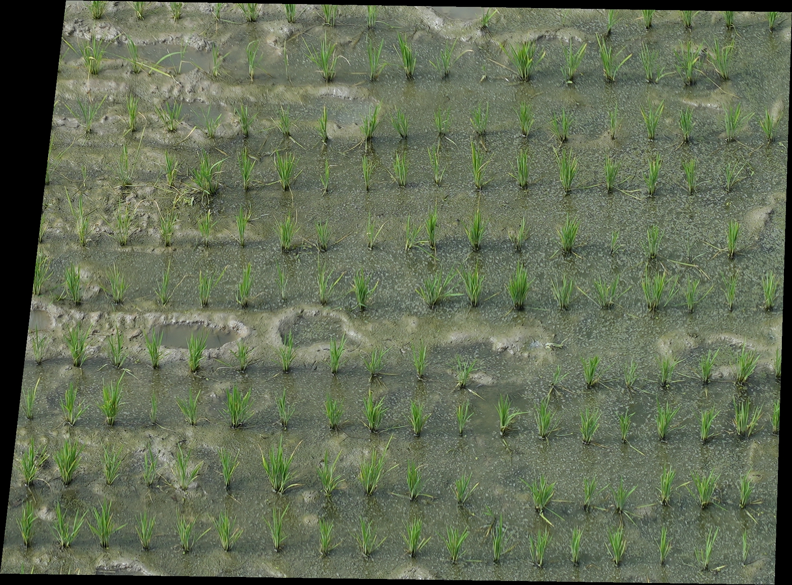
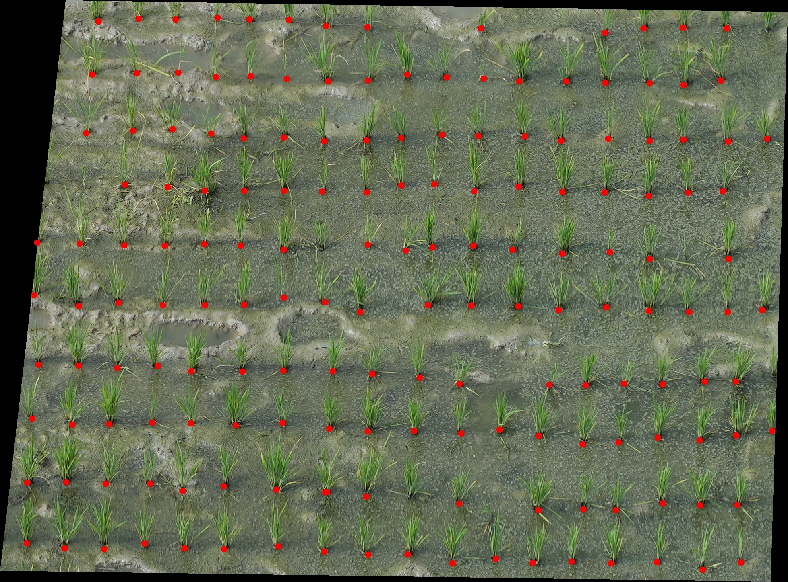
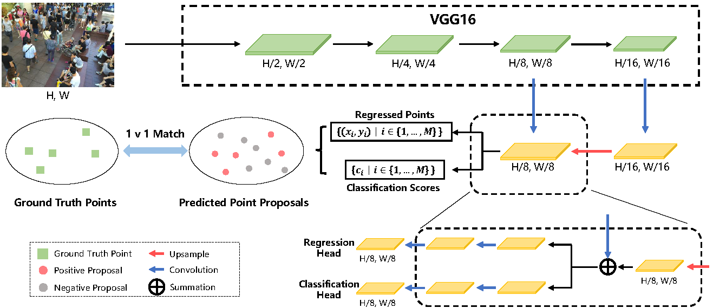

# Rice Planting-Hill Detection with P2PNet

A **P2PNet** model adapted to detect rice **planting hills (hills)** in UAV RGB
images. The model was trained on more than 1,600 manually annotated UAV images
and allows high-throughput localization of every rice hill from field RGB
images.

This is a **well-trained model that can be used directly** — only the inference
code and the environment configuration are provided here. Training code and the
manual-annotation dataset are not released; the network architecture and the
training procedure are described in the accompanying paper.

| Input UAV image | Detected hills (red dots) |
| --- | --- |
|  |  |

## Model architecture

P2PNet consists of a **VGG16_bn** backbone, a **feature-pyramid (FPN) decoder**,
and two task heads:

- a **point-regression head** that predicts an (x, y) offset for each reference
  point laid out on a regular grid;
- a **classification head** that outputs a foreground confidence for each point.

Points whose confidence is above a threshold are kept as detected hills.



## Hardware

A CUDA GPU is recommended (the model was developed and tested on NVIDIA GPUs with
CUDA 10.2). The script also runs on CPU when no GPU is available, more slowly.

## Environment configuration

The code was run with **Python 3.7**, **PyTorch 1.9.0** and **torchvision
0.10.0**.

**Option A — conda** (exact frozen environment, see `environment.yml`):

```bash
conda env create -f environment.yml
conda activate wheat_detection
```

**Option B — pip** (see `requirements.txt`):

```bash
pip install -r requirements.txt
```

## Prepare the files

1. Download the trained checkpoint **`best_mae.pth`** from the GitHub Release
   (link below) and place it in the `checkpoints/` folder.
2. Put the UAV images to process in the `input/` folder.

The ImageNet-pretrained VGG16_bn weights are downloaded automatically on the
first run. Alternatively, you can download `vgg16_bn-6c64b313.pth` yourself and
place it in the `models/` folder.

**Downloads**

- Trained hill-detection checkpoint (`best_mae.pth`): **<PASTE_GITHUB_RELEASE_LINK>**
- (Optional) VGG16_bn ImageNet weights:
  https://download.pytorch.org/models/vgg16_bn-6c64b313.pth

## Run

```bash
python predict.py
```

Or specify the paths explicitly:

```bash
python predict.py --input_dir ./input --output_dir ./output \
    --weight_path ./checkpoints/best_mae.pth --threshold 0.55
```

For each input image, the script writes to the `output/` folder:

- an annotated image with red dots on the detected hills;
- a `.txt` file with one `x y` coordinate per line, in the original image
  resolution.

## Citation

If you use this model, please cite the accompanying paper:

```bibtex
@article{shi2026spatial,
  title  = {Spatial uniformity links potential growing space to canopy development and yield formation in rice},
  author = {Shi, Ming and Gao, Yangmingrui and Ding, Yanfeng and Li, Weiwei and Liu, Shouyang},
  journal = {},
  volume  = {},
  pages   = {},
  year   = {2026},
  doi    = {}
}
```

## License

Released under the [MIT License](LICENSE).
